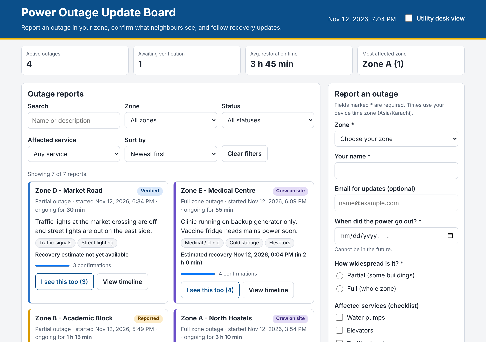
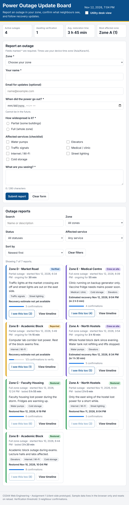
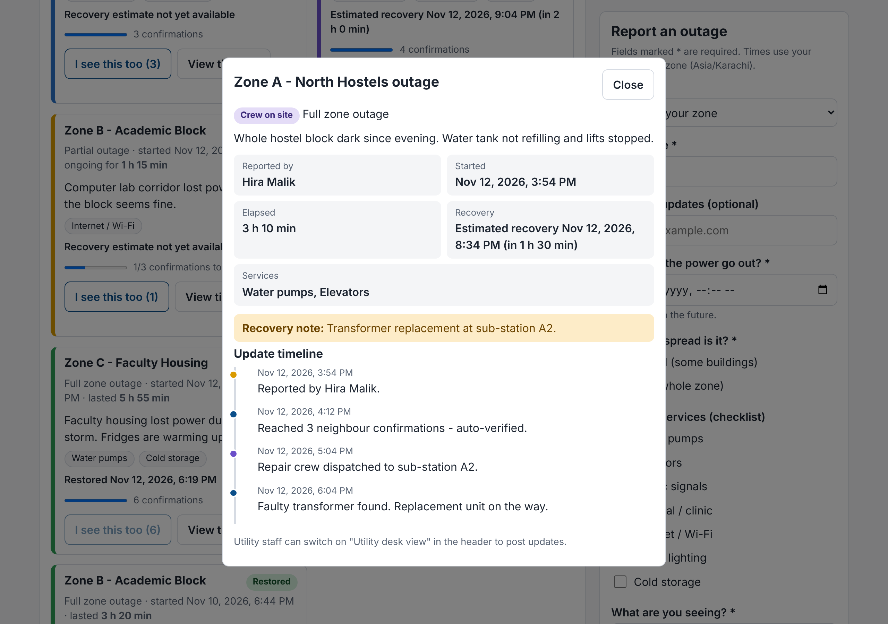

# Power Outage Update Board

CS344 Web Engineering - **Assignment 1: Client-side web application**

| | |
|---|---|
| **Assigned idea** | #24 - Power Outage Update Board |
| **Group extension** | Outage reports by zone, verification, update timeline, affected-service checklist, recovery estimate notes |
| **Concepts** | Event/status history, filtering, validation, accurate timestamp handling (APIs and authentication follow in Assignments 2-3) |
| **Individual rule / data variant** | `<write the rule given by your instructor here>` - the verification threshold (`VERIFY_THRESHOLD`) and duplicate window (`DUPLICATE_WINDOW_HOURS`) in `js/data.js` are the easiest places to apply it |
| **Student** | `<your name / roll number>` |

A responsive single-page app built with semantic HTML, CSS and vanilla JavaScript only (no frameworks, no backend).

## User and workflow

Residents of a zoned campus report a power outage, neighbours confirm it until it is verified, and a utility desk posts status updates and recovery estimates. See [docs/design-note.md](docs/design-note.md) for the user/problem, WDLC stages, browser-vs-server split and wireframes ([docs/wireframe.svg](docs/wireframe.svg)).

## Features

- **Report form** with zone, name, optional email, start time (`datetime-local`, not in the future), severity radios, affected-service checklist and description with live character counter.
- **Filter / search / sort** by text, zone, status, affected service; live result count and empty state.
- **Verification**: "I see this too" confirmations (once per report per browser); a report auto-verifies at 3 confirmations, with a progress bar.
- **Duplicate check**: reporting in a zone that already has an active report near the same time offers to confirm the existing one instead.
- **Update timeline** per outage (dialog) with timestamps in your device time zone.
- **Utility desk view** (header toggle): post forward-only status changes (Reported -> Verified -> Crew on site -> Restored), a note and a recovery estimate (must be after the start time). This is a demo toggle only; real access control comes in Assignment 3.
- **Live calculations**: elapsed time or outage length, time to/overdue on estimate, average restoration time, most affected zone.
- **Invalid and empty input** handled: browser validation plus JavaScript checks with an error summary.
- **Seven sample records** (`js/data.js`) with times generated relative to "now".

## Run it

No installation is needed.

1. Download or clone the repository.
2. Open `index.html` in a modern browser (Chrome, Edge, Firefox, Safari).

Optional local server:

```bash
cd power-outage-board
python3 -m http.server 8000
# open http://localhost:8000
```

Optional hosting: GitHub repository -> Settings -> Pages -> Deploy from branch `main`, folder `/ (root)`. The app URL will be `https://<username>.github.io/<repo>/`.

## Project structure

```
index.html          page structure (semantic HTML, forms)
css/styles.css      variables, Grid/Flexbox, breakpoints at 640px and 1000px
js/data.js          constants (zones, services, thresholds) and 7 sample records
js/app.js           state, rules, rendering, events
docs/design-note.md user/problem, WDLC, client vs server, wireframe notes
docs/wireframe.svg  desktop and mobile wireframes
docs/screenshots/   desktop, tablet, mobile, timeline dialog
```

## Screenshots

| Desktop (1280 px) | Tablet (768 px) | Mobile (375 px) |
|---|---|---|
|  |  |  |

Timeline dialog:



## Requirement checklist

| Requirement | Where |
|---|---|
| Semantic HTML only, vanilla JS, no framework | `header`, `main`, `section`, `aside`-style panels, `form`, `dialog`, `footer`; no libraries |
| Defined user, core workflow, labelled form with validation | `docs/design-note.md`; `#report-form` with `required`, `minlength`, `type=email`, `datetime-local` |
| Selectors, box model, Flexbox/Grid, 2+ breakpoints | `css/styles.css` (640 px, 1000 px) |
| Variables, functions, arrays, conditionals, DOM events | `js/app.js` |
| 2+ interactions | filtering/sorting, confirmation/verification, duplicate checking, calculations, desk updates |
| Empty and invalid input | empty-state panel, `validateReport()`, update-form checks |
| 6+ sample records | `buildSampleReports()` returns 7 |
| Wireframe and design note | `docs/` |

## Testing performed

Scripted browser run (Playwright/Chromium) covering: initial render, zone/status filters, no-match empty state, clearing filters, confirmation count and one-per-browser limit, auto-verification, browser blocking empty submit, future time rejected, valid submit, duplicate warning and "submit anyway", HTML in input rendered as plain text (no injection), desk update validation and restoring an outage, no console errors, and no horizontal scrolling at 1280, 768 and 375 px widths.

## Walkthrough tips (for the live demo)

- Small live-change ideas: change `VERIFY_THRESHOLD` in `js/data.js`; add a zone to `ZONES` or a service to `SERVICES`; change a breakpoint in `css/styles.css`.
- Be ready to explain: `applyFilters()` (array filter + sort), `confirmReport()` (verification rule), `validateReport()` (edge cases), `toLocalInput()` (why local time is needed for `datetime-local`), and why `textContent` is used instead of `innerHTML`.

## Attribution

All code, data and text were written for this assignment. Fonts are the system font stack. No third-party libraries or images.
